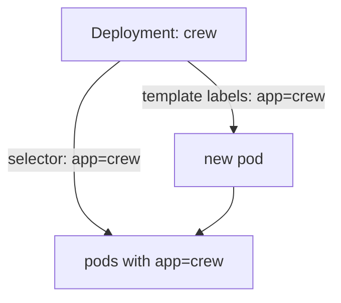

# Scale And Label The Fleet

A fleet order says how many ships to keep in flight. When the work grows, you ask for more ships. When you need to find some of them, you read their labels. This part shows both moves on a healthy fleet in your playground.

## Scale a Deployment

A Deployment has a field called `replicas`: the number of pods it keeps running. Picture it as the number on the fleet order. Change the number, and the Deployment controller in mission control builds or removes ships until the real count matches.

### Read the fleet order first

Look at the Deployments on the planet:

<!-- astrona:playground:renew -->

```sh
kubectl get deployments -n fleet-lab
```

You should see two rows, `cargo` and `crew`. The `READY` column shows two numbers, for example `1/1`. The first number is how many pods are ready. The second is how many the fleet order asks for. `UP-TO-DATE` counts pods built from the newest version of the order, and `AVAILABLE` counts pods that are ready to serve.

### Ask for more ships

Change `crew` from 1 to 3 ships:

```sh
kubectl scale deployment/crew --replicas=3 -n fleet-lab
```

`kubectl` answers with one line that says the Deployment was scaled. This changes the `replicas` field of the Deployment, and nothing else. Now watch the fleet grow:

```sh
kubectl get pods -n fleet-lab
```

Two new `crew` pods appear. They may say `ContainerCreating` for a few seconds, then `Running`. Run the command again until all three show `1/1`.

### Ask for fewer ships

Scaling down works the same way. Set `crew` back to 1:

```sh
kubectl scale deployment/crew --replicas=1 -n fleet-lab
```

The controller picks two pods and removes them. One `crew` pod stays.

> [!TIP]
> After any change, read the Deployment again with `kubectl get deployment`. The `READY` column says in one glance whether the real count matches the ask.

## Labels and selectors

A cluster can hold hundreds of pods. A **label** is a small tag, a `key=value` pair, that you stick on an object so that you can find it later. Picture a coloured sticker on each ship's hull.

### Read the labels

Add `--show-labels` to the roll call:

```sh
kubectl get pods -n fleet-lab --show-labels
```

A new `LABELS` column shows the stickers. The `crew` pods carry `app=crew` and the `cargo` pods carry `app=cargo`. Kubernetes also adds a label of its own, `pod-template-hash`, that tells the batches of ships from one version of the order apart.

### Pick ships with a selector

A **selector** is a rule that picks objects by their labels. With `-l` you give one to `kubectl`:

```sh
kubectl get pods -n fleet-lab -l app=cargo
```

Only the `cargo` pods answer the roll call.

### Add and remove a label

You can put a sticker on a pod yourself. Take the name of one `cargo` pod from the roll call:

```sh
kubectl label pod <CARGO_POD_NAME> shift=night -n fleet-lab
kubectl get pods -n fleet-lab -l shift=night
```

Only that pod answers. To remove a label, repeat its key with a minus sign:

```sh
kubectl label pod <CARGO_POD_NAME> shift- -n fleet-lab
```

## How a Deployment finds its ships

A Deployment does not keep a list of its pods. It uses labels. The field `spec.selector.matchLabels` says "my pods are the ones with these labels". The field `spec.template.metadata.labels` gives those labels to every pod it builds. The two must match, or Kubernetes refuses the Deployment.



The Deployment gives every new pod the label `app=crew`, and later finds its ships by that same label.

This is why removing the label `app=crew` from a `crew` pod makes the Deployment build a replacement: the old pod is no longer one of its ships. A Service uses the same trick to find the pods it sends traffic to.

## Common pitfalls

> [!WARNING]
> - **Forgetting `-n`.** `kubectl scale` and `kubectl get` look in the `default` namespace without it. Add `-n fleet-lab`.
> - **Scaling the pods.** Scale the Deployment, as in `deployment/crew`. A pod cannot be scaled.
> - **Treating `READY 1/3` as done.** The second number is the ask. Wait until both numbers match.
> - **Labels that do not match the selector.** A Deployment whose template labels are not selected by its own selector is rejected.
> - **A typo in a label value.** `app=crw` is a different label from `app=crew`, and a selector with it finds nothing.

> *Scale changes the number on the fleet order. Labels are the stickers that let ships be found.*
