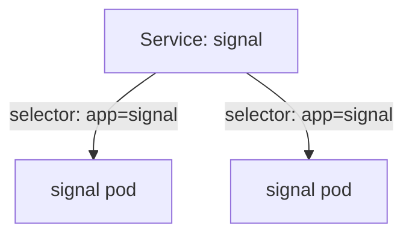

# Describe A Fleet In A File

Typing commands is good for a quick change. A fleet that matters should live in a file: you can read it, check it, keep it and launch it again. This part writes a Deployment and a Service as YAML files and gives them to Kubernetes.

YAML is a plain text format with keys and values, indented with spaces. Kubernetes reads it as the description of what you want.

## The parts of a Deployment file

A Deployment file has four top-level parts. You will see them in every Kubernetes file.

| Part | What it says |
| --- | --- |
| `apiVersion` and `kind` | Which kind of object this is. A Deployment is `apps/v1` and `Deployment` |
| `metadata` | The name, and the namespace it lives in |
| `spec` | What you want: the replicas, the selector, and the pod template |
| `spec.template` | The design of one pod: its labels and its containers |

### Write the fleet order

Save this as `deployment-signal.yaml`:

```yaml
apiVersion: apps/v1
kind: Deployment
metadata:
  name: signal
  namespace: fleet-lab
spec:
  replicas: 2
  selector:
    matchLabels:
      app: signal
  template:
    metadata:
      labels:
        app: signal
        tier: front
    spec:
      containers:
        - name: web
          image: nginx:1.27-alpine
          ports:
            - containerPort: 80
```

The `selector` says "my pods have `app=signal`". The template gives each pod `app=signal` and `tier=front`. The container is named `web`, and it opens the radio channel (port) `80`.

### Give the file to Kubernetes

Apply it:

<!-- astrona:playground:renew -->

```sh
kubectl apply -f deployment-signal.yaml
```

Then check the result:

```sh
kubectl get deployment signal -n fleet-lab
kubectl get pods -n fleet-lab -l app=signal --show-labels
```

You should see a Deployment with 2 ships, and two pods with both labels. The `kubectl apply` command compares the file with the cluster. It creates what is missing and changes what differs.

### Change the fleet by applying again

Open `deployment-signal.yaml` in an editor, change `replicas: 2` to `replicas: 4`, and save it. Apply the same file again:

```sh
kubectl apply -f deployment-signal.yaml
```

Kubernetes reports the Deployment as configured, and two more pods appear. The file is now the single source of truth for this fleet.

## A Service: one call sign for a fleet

Pods come and go, and each new pod gets a new address. A **Service** is a stable call sign: one name and one address that a whole group of ships answers to. Picture a beacon that always points at the ships that are in flight now.

A Service finds its ships with a selector on labels, the same way a Deployment does.

### Write the beacon

Save this as `service-signal.yaml`:

```yaml
apiVersion: v1
kind: Service
metadata:
  name: signal
  namespace: fleet-lab
spec:
  selector:
    app: signal
  ports:
    - port: 80
      targetPort: 80
```

The `selector` picks pods with `app=signal`. The `port` is the channel the Service listens on, and `targetPort` is the channel on the pod it forwards to. Apply it:

```sh
kubectl apply -f service-signal.yaml
```

Then check that the beacon found the ships:

```sh
kubectl get endpoints signal -n fleet-lab
```

The `ENDPOINTS` column lists one address and port for each ready pod. If it says `<none>`, the Service selector matches no pod: check the labels.



The Service sends traffic to every ready pod that carries the label `app=signal`.

## Common pitfalls

> [!WARNING]
> - **Wrong indentation.** YAML uses spaces, never tabs, and the indent shows which key belongs to which. A misplaced line gives an error or a silent wrong meaning.
> - **A selector that does not match the template labels.** Kubernetes rejects the Deployment.
> - **A Service selector with a typo.** The Service is created, but `ENDPOINTS` is `<none>`.
> - **Editing the file and forgetting to apply it.** The cluster only changes when you run `kubectl apply -f` again.
> - **Forgetting the namespace.** Put it in `metadata.namespace`, or add `-n` to the command.

> *Keep the fleet in a file. Apply it to launch it, apply it again to change it.*

## Your mission: Launch A Fleet From A File

You can now write a Deployment and a Service in files and apply them. Your mission: the planet `launch-lab` is empty, and you must launch a three-ship fleet called `relay` with the right labels and give it a Service.

Pause the playground first, so the lab has the memory it needs:

```sh
astrona stop ats-000-playground-020-01
```

Start the mission:

```sh
astrona run ATS000/section-020/module-01/lab-01
```

Read the task in [`question.md`](./labs/lab-01/question.md) and solve it on your own first, in a lab shell (`astrona shell`). When you think you are done, leave the lab shell and send it for grading:

```sh
astrona submit ATS000/section-020/module-01/lab-01
```

When the mission is done, remove the lab and start the playground again:

```sh
astrona destroy ats-000-lab-020-01-01
astrona start ats-000-playground-020-01
```
