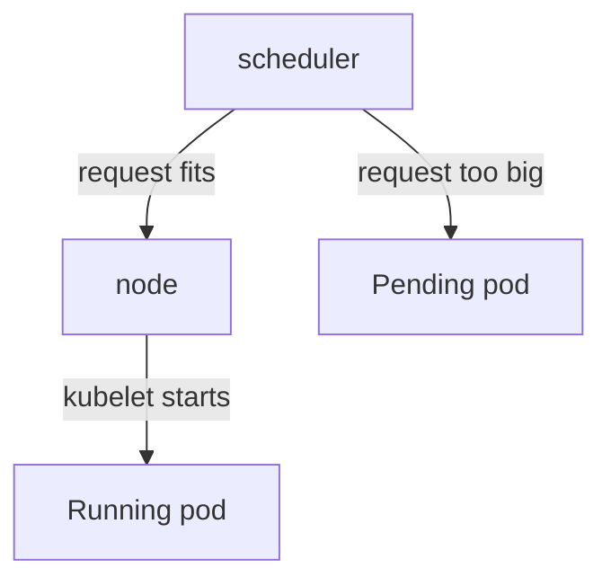

# Pending Ships: No Room On The Launch Pad

A pod is not built where you ask. Before it can start, Kubernetes must pick a node (a launch pad) with enough room for it. If no node has room, the pod waits. This part shows how to read that wait, and how to fix it.

## Who places a pod

The part of the control plane (mission control) that picks a node for each new pod is the **scheduler**. Picture a flight controller with a list of launch pads. For each new ship, the controller finds a pad with enough free capacity, and assigns the ship to it. Only then does the kubelet, the launch pad crew, start the ship.

### Requests: how much room a ship needs

A container can state how much it needs. A **resource request** says "reserve at least this much for me". The scheduler adds up the requests of the pods on a node, and only places a new pod if its request still fits. A memory request is written with units such as `64Mi` (about 64 megabytes) or `2Gi` (about 2 gigabytes).

If a request is bigger than the free memory of every node, the scheduler cannot place the pod. The pod stays in the status **Pending**: the ship exists as an order, but it has no launch pad.

## See a Pending pod

Your playground has a fleet order, `hauler`, with a request that no launch pad can meet.

### Read the roll call

Run a roll call on the planet:

<!-- astrona:playground:renew -->

```sh
kubectl get pods -n rescue-lab
```

You should see a `hauler` pod that is `0/1` and `Pending`. The `RESTARTS` column says `0`, because the container never started. This is the clue that tells `Pending` from a crash.

### Read the reason

Copy the `hauler` pod name and open its flight record:

```sh
kubectl describe pod <HAULER_POD_NAME> -n rescue-lab
```

Scroll to the Events at the bottom. You should find a `FailedScheduling` event from the `default-scheduler`. Its message says the pod could not be placed on the node, and names `Insufficient memory`. The word `Insufficient` is the clue: the node has less free memory than the pod asked for.

You can also read the Events of the whole planet, oldest first:

```sh
kubectl get events -n rescue-lab --sort-by=.metadata.creationTimestamp
```

> [!TIP]
> A pod that is `Pending` has not started, so it has no log. Skip `kubectl logs`, and read the Events instead.

## Fix the request in the fleet order

The request is part of the pod design, so it lives in the Deployment. Lower it there, and the Deployment controller builds a new pod with the new request.

### Set a request that fits

Use `kubectl set resources`, which changes the requests of a Deployment's container:

```sh
kubectl set resources deployment/hauler --requests=memory=64Mi -n rescue-lab
```

Then run the roll call again. The old pod is replaced by a new one, and after a few seconds the `hauler` pod is `1/1` and `Running`. The new pod has a new name, because it belongs to a new version of the fleet order.



The scheduler places a pod on a node only if its request fits. Otherwise, the pod waits as `Pending`.

## Other reasons for Pending

A request that is too big is the most common reason, but not the only one. The Events name the reason each time.

| Event says | Meaning |
| --- | --- |
| `Insufficient memory` or `Insufficient cpu` | The request is bigger than the free room on every node |
| `node(s) didn't match Pod's node affinity/selector` | The pod asks for nodes with a label that no node has |
| `node(s) had untolerated taint` | The nodes are marked to keep this kind of pod away |

Taints and node selectors are outside this module. The point to remember is that the Events always say which one it is.

## Common pitfalls

> [!WARNING]
> - **Running `kubectl logs` on a Pending pod.** The container never started, so there is no log.
> - **Deleting the pod.** The Deployment builds a new one with the same request, and it is `Pending` again.
> - **Setting the request to a smaller number but a wrong unit.** `64Gi` and `64Mi` differ by a factor of a thousand. Read the unit.
> - **Confusing Pending with ImagePullBackOff.** `Pending` means no node was found. `ImagePullBackOff` means a node was found, but the image could not be pulled.

> *`Pending` means no launch pad. Read the Events, and make the order fit.*
