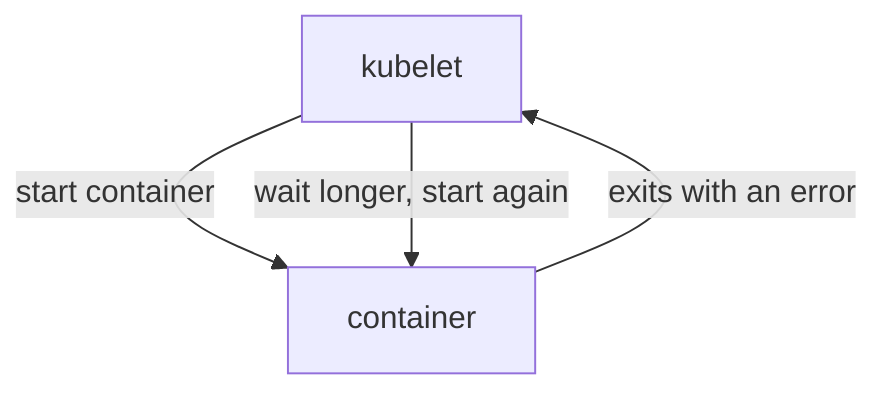

# Crashing Ships And Their Logs

Some ships do get a launch pad and a blueprint. They start, fail at once and start again. This part shows how to tell this failure from the others and how to read the ship's own log to find the cause.

## CrashLoopBackOff

When a container stops by itself, the kubelet starts it again. Each restart is followed by a longer wait. The status **CrashLoopBackOff** means "the container keeps crashing, and the kubelet is backing off between restarts". Picture a ship that lifts off, loses power and falls back, again and again.

### Tell the stuck kinds apart

Three statuses you now know point to three different places to look:

| Status | What happened | Look here |
| --- | --- | --- |
| `Pending` | No node had room | Events in `kubectl describe pod` |
| `ImagePullBackOff` | The image could not be pulled | Events in `kubectl describe pod` |
| `CrashLoopBackOff` | The container starts and stops | `kubectl logs` and the exit code |

## See a crash

Your playground has a fleet order, `flicker`, whose container stops at once.

### Read the roll call

Run a roll call on the planet:

<!-- astrona:playground:renew -->

```sh
kubectl get pods -n rescue-lab
```

You should see a `flicker` pod with a status such as `Error` or `CrashLoopBackOff`, and a `RESTARTS` number above `0` that grows over time. The container did start, and it keeps stopping.

### Read the ship's log

A container writes messages to its **log**. Think of it as the ship's black box. Read it with `kubectl logs`:

```sh
kubectl logs <FLICKER_POD_NAME> -n rescue-lab
```

You should see one line that says the file `/etc/app/app.conf` is missing. That line is the message the container printed before it stopped.

When a container has been restarted, the log you read is the log of the newest run. To read the run before it, add `--previous`:

```sh
kubectl logs <FLICKER_POD_NAME> -n rescue-lab --previous
```

### Read the exit code

Open the flight record and look at the part about the container:

```sh
kubectl describe pod <FLICKER_POD_NAME> -n rescue-lab
```

Under the container, find `Last State: Terminated`. It shows a `Reason` and an `Exit Code`. An exit code of `0` means the program ended without an error. Any other number means it failed. Here the exit code is `1`.

> [!TIP]
> Read the log first, then the exit code. The log usually names the cause, and the exit code tells you whether the program stopped on its own or was killed.

## Fix the command in the fleet order

The `flicker` container does not run the image's normal program. The Deployment replaces it with a `command` that prints an error and exits. Remove that command, and the image starts nginx as it should.

### Edit the Deployment

Open the Deployment in your editor with `kubectl edit`:

```sh
kubectl edit deployment/flicker -n rescue-lab
```

Find the `command:` list under the container named `web`, and delete the `command` key and its lines. Save and close the editor. Kubernetes applies the change when you save.

The same fix without an editor is a patch that removes the field:

```sh
kubectl patch deployment/flicker -n rescue-lab --type=json -p='[{"op":"remove","path":"/spec/template/spec/containers/0/command"}]'
```

Run the roll call again. The Deployment builds a new pod, and after a few seconds it is `1/1` and `Running`.



The kubelet restarts the container every time it stops, and waits longer each time. That is the loop in the name.

## Common pitfalls

> [!WARNING]
> - **Reading only the newest log.** After many restarts, the interesting run may be the one before. Add `--previous`.
> - **Deleting the pod to "restart" it.** The Deployment builds a new pod from the same order, and it crashes in the same way.
> - **Waiting for a crash loop to fix itself.** A container that fails for a reason in its design will keep failing.
> - **Forgetting `-n`.** Without it, `kubectl logs` looks for the pod in the `default` namespace.
> - **Closing `kubectl edit` without saving.** Nothing changes, and the pod keeps crashing.

> *Look at the status, then look in the right place: Events for Pending and image problems, logs for crashes.*

## Your mission: Rescue Two Stuck Ships

You can now tell a ship with no launch pad from a ship that keeps crashing, and fix both in the fleet order. Your mission: on the planet `rescue-lab`, one ship is `Pending` and another crashes at once. Find out why and bring both into flight.

Pause the playground first, so the lab has the memory it needs:

```sh
astrona stop ats-000-playground-020-02
```

Start the mission:

```sh
astrona run ATS000/section-020/module-02/lab-01
```

Read the task in [`question.md`](./labs/lab-01/question.md) and solve it on your own first, in a lab shell (`astrona shell`). When you think you are done, leave the lab shell and send it for grading:

```sh
astrona submit ATS000/section-020/module-02/lab-01
```

When the mission is done, remove the lab and start the playground again:

```sh
astrona destroy ats-000-lab-020-02-01
astrona start ats-000-playground-020-02
```
