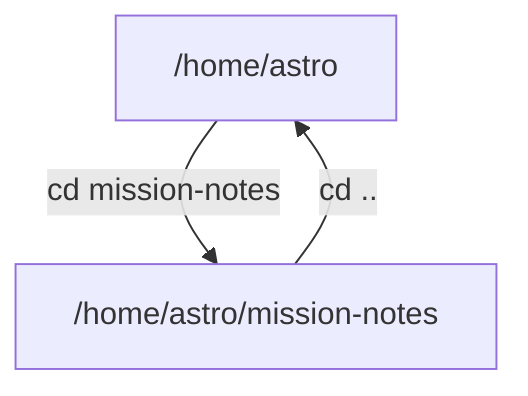

# Where You Are: Paths And Folders

Every terminal window is "standing" in one folder at a time. Commands that use files look in that folder first. This part teaches you to see where you stand and to move around.

## Always know where you stand

A **folder** (also called a directory) holds files and other folders. The terminal always has a **current folder**. Think of it as the room of the space station where you are standing right now.

### See it with pwd

Type `pwd`, which means "print working directory":

```console
$ pwd
/home/astro
```

The text is the **path**: the full address of the folder. Each `/` goes one folder deeper. On macOS your path looks like `/Users/astro`; on Linux and WSL it looks like `/home/astro`. Your user name will differ.

### Look around with ls

Type `ls` to list what is in the current folder:

```console
$ ls
Desktop  Documents  Downloads
```

Your list will differ. Add `-l` for a longer list with sizes and dates, and `-a` to also show hidden files, whose names start with a dot.

## Move around

You move with `cd`, which means "change directory". Give it the folder you want.

### Go into a folder and back out

Make a folder for your notes, go into it and check where you are:

```console
$ mkdir mission-notes
$ cd mission-notes
$ pwd
/home/astro/mission-notes
```

Now go one folder up with `..`, which always means "the folder above this one":

```console
$ cd ..
$ pwd
/home/astro
```

Three more moves are worth learning: `cd` on its own (or `cd ~`) takes you to your home folder, `cd -` takes you back to the folder you were in before, and `ls ..` lists the folder above without moving.

> [!TIP]
> Press the Tab key while you type a folder name. The terminal completes the name, or shows the choices if there are several. It saves typing and avoids spelling mistakes.

## Absolute and relative paths

A path can be written two ways. The two ways point to the same place, but they start from a different spot.

### Two ways to write one address

An **absolute path** starts with `/` and works from anywhere, like a full address with the planet and the street. A **relative path** does not start with `/` and starts from the current folder, like "two doors down on the left".

```console
$ cd /home/astro/mission-notes
$ cd ..
$ cd mission-notes
```

The first line uses an absolute path. The last line uses a relative path, which only works because the previous line moved you to `/home/astro`. If the relative path does not work, run `pwd` first: you are probably standing somewhere else.

The shortcuts: `.` means the current folder, `..` means the folder above, and `~` means your home folder.



The picture shows that `cd mission-notes` goes down one folder, and `cd ..` goes back up.

## Common pitfalls

> [!WARNING]
> - **Typing a command in the wrong folder.** Run `pwd` when a file "cannot be found". The file may be in the folder above.
> - **Spaces in names.** `cd my notes` means two names. Avoid spaces in names, or put the name in quotes.
> - **Mixing up `.` and `..`.** One dot is here. Two dots are one level up.
> - **Capital letters.** On macOS and Linux, `Notes` and `notes` are two different names.
> - **Typing the `$`.** The `$` in the blocks only marks the start of a command. Type what comes after it.

> *`pwd` tells you where you stand, `ls` shows what is around you, and `cd` moves you.*
