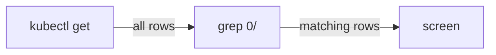

# Pipes And Filters

A roll call can have fifty lines. You only care about three. A pipe lets you pass the output of one command to another that keeps only what you want.

## The pipe

Every command prints its result to a stream called the **standard output**. A **pipe**, written `|`, connects that output to the input of the next command. Think of it as a hose between two stations on the ship: the first station pumps text out, the second one filters it.

### Count and filter

Use files in your notes folder to try it. This command lists the files and counts the lines:

```console
$ ls ~/mission-notes | wc -l
2
```

The `wc -l` command counts lines. Here it counts the names that `ls` printed. Your number will differ.

Now filter. The `grep` command keeps only the lines that contain a word:

```console
$ cat ~/mission-notes/plan.txt | grep fuel
check the fuel
```

Useful flags: `grep -i` ignores capital letters, `grep -v` keeps only the lines that do **not** contain the word, and `grep -c` counts the matching lines.

## Pipes with kubectl

`kubectl get` prints a table. The pipe turns that table into a quick search tool. Your playground has the planet `terminal-lab`.

### See it in your playground

Run a roll call first:

```sh
kubectl get deployments -n terminal-lab
```

You should see three rows: `alpha` with `2/2`, `beta` with `1/1` and `gamma` with `0/0`. The `READY` column reads "ships in flight over ships asked for".

Now keep only the lines with a zero:

```sh
kubectl get deployments -n terminal-lab | grep 0/
```

Only the `gamma` row appears, because it is the only one with `0/` in it. Other useful forms:

```sh
kubectl get deployments -n terminal-lab | grep -v 1/1
kubectl get deployments -n terminal-lab | wc -l
kubectl get deployments -n terminal-lab | sort
```

The first hides the `beta` row. The second counts the rows, and the count includes the header line. The third sorts the rows by name.



The pipe sends all rows from `kubectl` to `grep`, and only the matching rows reach the screen.

## Save output in a file

A redirect sends output into a file instead of the screen. Combine it with a pipe and you can keep a record of what you saw:

```sh
kubectl get deployments -n terminal-lab > roll-call.txt
kubectl get deployments -n terminal-lab | grep 0/ >> roll-call.txt
cat roll-call.txt
```

The file now holds the whole roll call, then the filtered lines. Error messages travel on a second stream. To save them too, add `2>&1`: for example `kubectl get pods -n wrong-name > out.txt 2>&1`.

> [!TIP]
> When a command prints too much, add `| less` to read it page by page, or `| head -n 20` to see only the start.

## Common pitfalls

> [!WARNING]
> - **Pipes keep only the output, not the colours or the header.** A filter can remove the header line. That is normal.
> - **`grep` matches pieces of words.** `grep 0/` also matches `10/10`. Read the lines you get.
> - **A wrong namespace gives an empty result.** An empty roll call and a typo look alike. Check `-n`.
> - **Using `>` with a name that exists.** The old file is replaced. Use `>>` to add to the end.
> - **Pipes cannot change the cluster.** `grep` only filters text. To scale or fix something, you still run `kubectl scale` or `kubectl set image`.

> *Pump the text out, filter it with `grep`, count it with `wc`, and keep it with `>`.*
