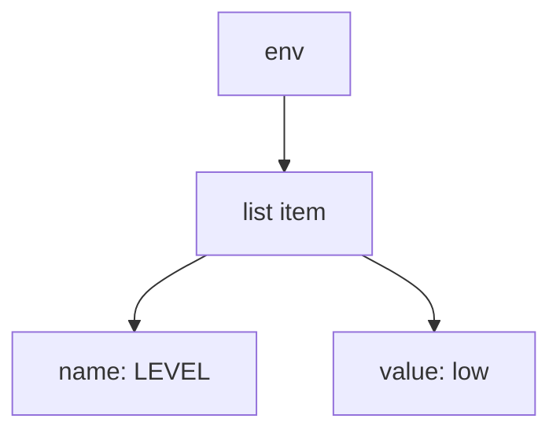

# Maps, Lists And Indentation

YAML is a way to write structured information as plain text. Kubernetes reads it. It has only three shapes, and you can learn all of them in one sitting.

## The three shapes

Every YAML file is built from three shapes: a single value, a list and a map. A file can nest them inside each other.

### A key and a value

The simplest shape is a name, a colon, a space and a value:

```yaml
name: radar
replicas: 2
```

The name is called the **key**. The colon must be followed by a space.

### A map

A **map** is a group of keys under one name. Think of a ship's cargo manifest: one heading, and below it the items. The items sit two spaces to the right of the heading:

```yaml
labels:
  app: radar
  tier: front
```

Here `labels` is a map with two keys, `app` and `tier`.

### A list

A **list** is a row of items. Each item starts with a dash and a space:

```yaml
ports:
  - 80
  - 443
```

A list item can itself be a map. The dash starts the first key of the item, and the other keys line up with it:

```yaml
containers:
  - name: scanner
    image: nginx:1.27-alpine
```

This is a list with one item. The item is a map with the keys `name` and `image`. Both keys start in the same column.

## Indentation is the structure

YAML has no brackets. The spaces at the start of each line show what belongs to what. A line that is further right belongs to the line above it that is further left.

### Spaces, never tabs

Use two spaces for each level. Never use the Tab key: YAML does not accept tabs for indentation. Most editors can insert spaces when you press Tab, but a plain terminal editor may not. In `nano`, type the spaces yourself.

### See it in your playground

Print the sample Deployment as YAML:

<!-- astrona:playground:renew -->

```sh
kubectl get deployment sample -n draft-lab -o yaml
```

You should see a long file. Find the line `labels:` and the lines under it. Find the line `containers:` and the dash under it. Kubernetes has added extra fields, such as `status`, that you did not write. You will write only the parts it needs.

### Before and after

Two files that look alike, with a different meaning:

```yaml
env:
  - name: LEVEL
    value: low
```

```yaml
env:
  - name: LEVEL
  value: low
```

In the first, `value` belongs to the list item. In the second, `value` sits next to `env`, so it is a separate key, and the list item has no value. YAML accepts it, but Kubernetes refuses the result. One space changed the whole meaning.



The picture shows that `name` and `value` are both children of the same list item.

## Common pitfalls

> [!WARNING]
> - **Using the Tab key.** Use spaces only.
> - **No space after the colon.** `app:radar` is one word, not a key and a value.
> - **A dash line that is out of line.** The keys inside a list item must start in the same column.
> - **Mixing two and four spaces.** Pick two and keep it. A line that does not line up is a new level.
> - **Copying from a web page.** Hidden characters may come with the text. Look at the result in `nano`.

> *A dash starts a list item, a colon starts a value, and the spaces on the left tell you who belongs to whom.*
