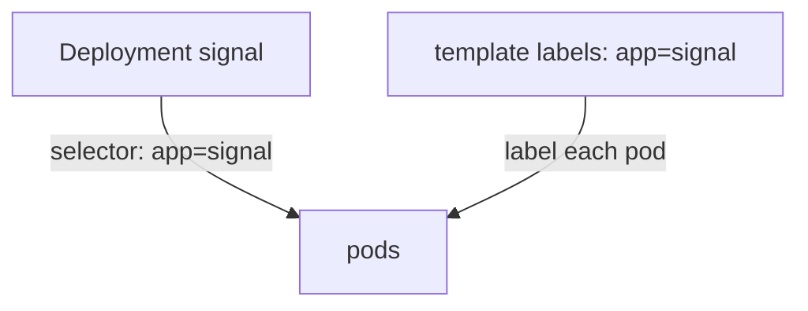

# Anatomy Of A Fleet Order

Every Kubernetes file has the same four top-level parts. Learn them once, and you can open any file and know where to look.

## The four parts

Every object in Kubernetes is described with four keys at the left edge. Think of a fleet order as a form with four boxes: what kind of form it is, its name tag, the details, and the status that mission control fills in.

| Key | What it says |
| --- | --- |
| `apiVersion` | Which version of the language this form uses. A Deployment uses `apps/v1` |
| `kind` | What type of object this is: `Deployment`, `Service`, `Namespace` |
| `metadata` | The name tag: `name`, `namespace` and `labels` |
| `spec` | The details of what you want. You write this |

A fourth box, `status`, shows what is true right now. Kubernetes writes it. You never write it.

### See the four parts

Print the sample Deployment and look at the left edge of the file:

```sh
kubectl get deployment sample -n draft-lab -o yaml
```

You should see `apiVersion`, `kind`, `metadata`, `spec` and `status` at the left edge. Everything else sits further to the right.

## A Deployment line by line

Here is a small Deployment. Save it as `deployment-signal.yaml`, in the folder where you keep your missions:

```yaml
apiVersion: apps/v1
kind: Deployment
metadata:
  name: signal
  namespace: draft-lab
spec:
  replicas: 2
  selector:
    matchLabels:
      app: signal
  template:
    metadata:
      labels:
        app: signal
    spec:
      containers:
        - name: web
          image: nginx:1.27-alpine
          ports:
            - containerPort: 80
```

Read it from the top. It is a Deployment named `signal` on the planet `draft-lab`. It asks for 2 ships. The `selector` says "my ships are the ones labelled `app: signal`". The `template` is the blueprint for each ship: its label, and one container named `web` that runs the image and listens on port 80.

### The rule that catches beginners

The selector and the template labels must match. The Deployment uses the selector to find its ships, and the template gives the label to the ships it builds. If they differ, Kubernetes refuses the file.

## More than one object in a file

A single file can hold several objects, separated by a line with three dashes:

```yaml
apiVersion: v1
kind: Namespace
metadata:
  name: draft-two
---
apiVersion: v1
kind: Namespace
metadata:
  name: draft-three
```

`kubectl apply -f` creates both objects. Save this as `namespaces-draft.yaml` and apply it, so you see it work:

```sh
kubectl apply -f namespaces-draft.yaml
```

You should see one `created` line for each namespace. Remove them again with `kubectl delete -f namespaces-draft.yaml`.



The Deployment finds its pods by the selector, and the template puts the same label on every new pod.

## Common pitfalls

> [!WARNING]
> - **A selector that does not match the template labels.** The file is refused.
> - **Writing `status`.** Kubernetes fills it in. Leave it out.
> - **Forgetting `namespace`.** The object lands in the namespace your command names, or in `default`.
> - **A wrong `apiVersion` for the kind.** A Deployment is `apps/v1`. A Service or Namespace is `v1`.
> - **Copying a printed object back into a file.** It carries fields such as `uid` that you must remove first.

> *Four boxes: `apiVersion`, `kind`, `metadata`, `spec`. Match the selector to the template label.*
