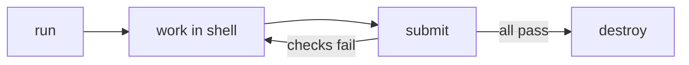

# Inside A Lab: Shell, Docs And Switching

Once a lab is running, you work in it. This part shows how to open a lab shell, read the task, and move between environments without losing your work.

## The lab shell

`astrona shell` opens a terminal that is already pointed at your lab's cluster. Anything you type with `kubectl` goes to that cluster and nowhere else.

### Open it and look around

```sh
astrona shell
echo $KUBECONFIG
kubectl get namespaces
exit
```

`$KUBECONFIG` is the file that tells `kubectl` which cluster to use. Inside the lab shell it points to the lab. After `exit`, you are back in your own terminal.

### Why use it

Your normal terminal may point at another cluster. The lab shell removes that risk. Always do lab work in the lab shell. If you forgot, run `kubectl config current-context` to see where you are.

## Read the task

The task and its background are one command away.

### The docs commands

```sh
astrona docs question
astrona docs case-study
astrona docs prerequisites
astrona docs solution
```

`question` prints the task. `case-study` gives the story and a few notes. `prerequisites` lists what you should already know. `solution` shows a walkthrough. Try the question and the case study on your own first; open the solution only after you tried the lab.

## Several environments at once

You may have a playground and a lab on the same machine. The CLI keeps a list and one of them is the current one.

### See them and switch

```sh
astrona status
astrona list
astrona use ats-000-playground-040-01
```

`astrona list` shows every environment. `astrona status` shows the current one. `astrona use` makes another one current, by its name. After that, `astrona shell` and `astrona submit` act on it.

### Pause and resume

A cluster uses memory. You can pause one you are not using, and bring it back later with its state kept:

```sh
astrona stop ats-000-playground-040-01
astrona start ats-000-playground-040-01
```

Stopping before a bigger lab is a good habit when your computer is small.



The loop in the picture is the whole workflow: run, work, submit, repeat until it passes, then destroy.

## Common pitfalls

> [!WARNING]
> - **Working in your own terminal.** Use `astrona shell`, or check `kubectl config current-context`.
> - **Submitting the wrong environment.** Run `astrona status` first when you have more than one.
> - **Reading the solution too early.** It spoils the learning.
> - **Forgetting to leave the shell.** Type `exit` before `astrona submit`.
> - **Keeping many clusters running.** Stop what you do not use.

> *Work in the lab shell, read the question, and know which environment is current.*
