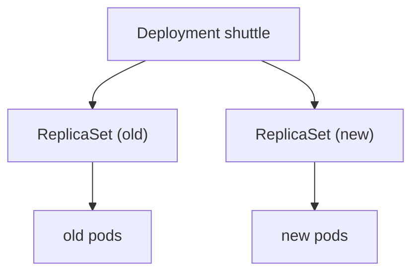

# How A Rollout Works

A Deployment does not run pods by itself. It owns a **ReplicaSet**, and the ReplicaSet owns the pods. When you change the pod template, the Deployment makes a new ReplicaSet and slowly moves the ships from the old one to the new one.

## Deployment, ReplicaSet and pods

The three objects work as a chain.

### See the chain

```sh
kubectl get deployment shuttle -n rollout-lab
kubectl get replicasets -n rollout-lab
kubectl get pods -n rollout-lab
```

You should see one Deployment, one ReplicaSet with a name that starts with `shuttle-`, and three pods with the same start. The ReplicaSet name ends in a hash of the pod template.



During a rollout, both ReplicaSets exist. The old one shrinks and the new one grows.

## What starts a rollout

Only a change to the **pod template** starts a rollout. That means the image, the environment, the ports, the command and similar fields.

### What does not

Changing `replicas` does not create a new revision. It only scales the current ReplicaSet. Changing a label on the Deployment itself, outside the template, does not either.

## Rolling update

By default, Kubernetes replaces pods a few at a time, so some ships always fly. Two settings control the pace: `maxSurge` (how many extra pods may exist) and `maxUnavailable` (how many may be missing). If the new pods never become ready, the rollout stops moving and the old pods keep serving.

## Common pitfalls

> [!WARNING]
> - **Thinking scaling is a release.** It makes no new revision.
> - **Editing the pods.** They belong to a ReplicaSet and will be replaced.
> - **Deleting an old ReplicaSet.** It holds your history.
> - **Assuming a stuck rollout means an outage.** The old pods keep running.
> - **Looking at the wrong ReplicaSet.** Match the hash to the revision.

> *Only a pod template change starts a rollout, and the old pods keep flying until the new ones are ready.*
